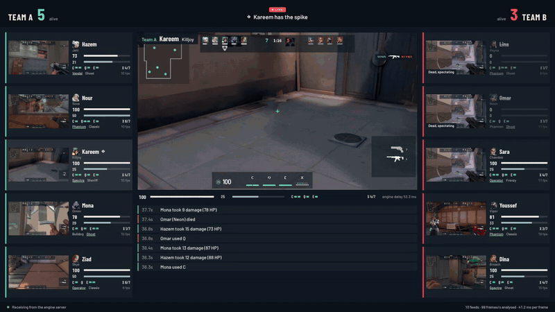
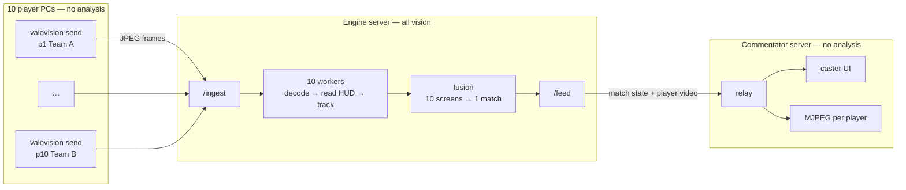
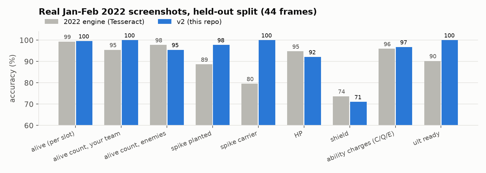
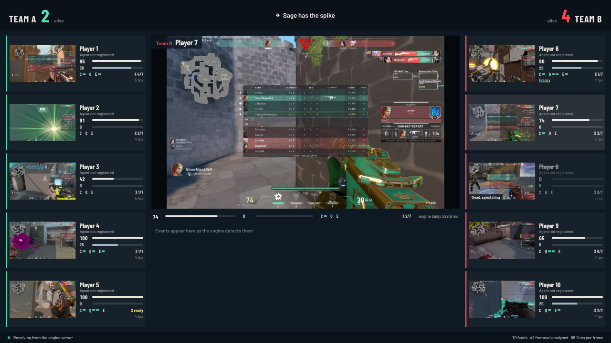
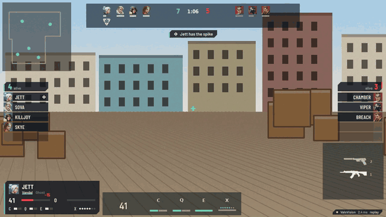
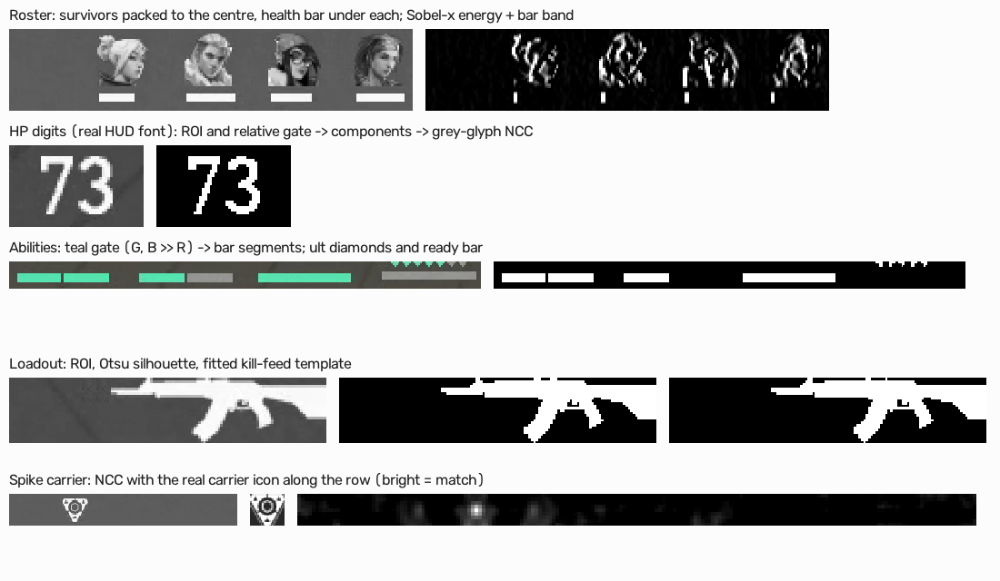
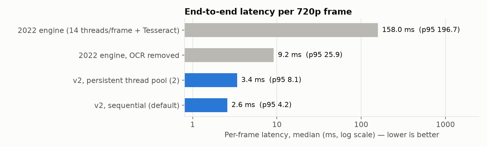

# ValoVision — live VALORANT (2022) match data from 10 player screens, with classical computer vision

**Ten players stream their screens to one engine server. The engine reads every HUD with classical image processing (no neural networks), fuses the ten views into one match state, and passes state and video to a commentator server that shows the whole match.**



*Commentator view during the 10-player demo ([full 30 s video](samples/match_demo_replica.mp4)): every tile is a live player feed with the HP, shield, charges, ult and loadout the engine read from that player's screen, and the focus view switches player every 3 s. The match bar and the spike state are voted across all ten screens. Each player's world view is a real January–February 2022 screenshot (HUD cropped away) with aim sway; the HUD on top is the replica of one scripted round, so every reading can be scored.*

---

- [The system](#the-system)
- [Tested on real 2022 footage](#tested-on-real-2022-footage)
- [Quick start](#quick-start)
- [How each HUD element is read](#how-each-hud-element-is-read)
- [Results](#results)
- [Benchmark: 16 threads / 18 GB target](#benchmark-16-threads--18-gb-target)
- [Project history: 2022 to now](#project-history-2022-to-now)
- [Messages](#messages)
- [Repository layout](#repository-layout)
- [Limitations](#limitations)
- [Legal and credits](#legal-and-credits)

Docs: [System design](docs/SYSTEM.md) · [Installation manual](docs/INSTALLATION.md) · [Real-footage test](docs/REAL_FOOTAGE.md) · [Benchmark](docs/BENCHMARK.md) · [Analysis of the 2022 code](docs/ORIGINAL_ANALYSIS.md) · [Sample analysis](docs/SAMPLE_ANALYSIS.md)

## The system



| Role | Runs | Work done there |
|---|---|---|
| **Player PC** ×10 | `valovision send` | capture the screen, downscale to 1280 px, JPEG-encode, send. Nothing else |
| **Engine server** | `valovision engine` | every bit of vision: decode, read the HUD, track each player, fuse the 10 screens, publish |
| **Commentator server** | `valovision commentator` | receive state and video, relay them unchanged, serve the caster UI and per-player MJPEG feeds |

What the engine extracts from each screen: HP, shield, C/Q/E charges, ult points and ready, primary/secondary weapon and the equipped slot, both rosters (alive and agent per slot), spike planted and carrier. From the ten screens together it builds the match state:

- **Per player** (from their own screen while alive; frozen at death, because a dead player's screen shows a spectated teammate's HUD): alive, HP, shield, charges, ult, loadout, spike carrier.
- **Per team** (majority vote across screens): alive count and alive agents.
- **Round:** spike planted with a 45 s fuse, and the carrier.
- **Events:** death, damage, ability used, ult ready/used, spike picked up/dropped/planted.

Protocol, fusion rules, bandwidth and CPU sizing: [docs/SYSTEM.md](docs/SYSTEM.md).

## Tested on real 2022 footage

The engine was calibrated and tested on **89 hand-labelled player screenshots from January–February 2022** ([source repository](https://github.com/deepsidh9/Live-Valorant-Overlay), MIT). Thresholds were fitted on frames 0–44, and frames 45–88 are held out. On the held-out frames, compared with the original 2022 engine:





*The same three-tier system with all ten players streaming genuine 2022 screenshots ([`samples/match_demo_real.mp4`](samples/match_demo_real.mp4)). Each player streams one fixed real frame, so every feed stays unchanged. Every 3 s the commentator switches focus to the next player, and the overlay shows that player's engine readings. The frames come from different rounds of one player's games, so this demo shows real-pixel readings per player, not one coherent match. To reproduce it: `python tools/match_demo.py --mode real --static --focus-every 3 --real-root real --record match_real.mp4`.*

The real footage overturned several replica assumptions, and the engine was changed to match the real HUD. Dead players vanish and survivors pack toward the centre; living portraits have a health bar; charges are teal segments; the planted spike is a hollow red triangle; there is no bottom-left portrait in the player HUD; 16:10 screens scale the HUD by height. The full story, including where v2 is still behind Tesseract (HP 92% vs 95%, shield 71% vs 74%), is in [docs/REAL_FOOTAGE.md](docs/REAL_FOOTAGE.md).

## Quick start

Python ≥ 3.9, Node ≥ 18, ffmpeg. The full manual covers Windows, OBS and multi-PC setup: [docs/INSTALLATION.md](docs/INSTALLATION.md).

```bash
git clone <this repo> valorant-hud-vision && cd valorant-hud-vision
python -m venv .venv && source .venv/bin/activate          # Windows: .venv\Scripts\activate
pip install -e "engine[dev]"
cd overlay && npm install && npm run build && cd ..
```

**Whole system on one machine**, ten players replaying one synchronised round (the POVs ship in `samples/match_replica/`):

```bash
pip install playwright        # only for the recording; uses any installed Chromium
python tools/match_demo.py --mode replica --povs samples/match_replica --fps 12 --replay --focus-every 3 --record demo.mp4
```

**Real match** (one engine machine, ten player PCs, one commentator machine):

```bash
# engine server
OMP_NUM_THREADS=1 valovision engine --port 8000 --token SECRET
# every player PC (its own pid / team / lobby agent)
valovision send --engine ws://ENGINE_IP:8000/ingest --token SECRET --pid p1 --name Hazem --team A --agent Jett
# commentator machine  ->  open http://localhost:9000/
valovision commentator --engine ws://ENGINE_IP:8000/feed --token SECRET --port 9000
```

**Single-feed mode** (one screen, transparent OBS overlay, no match system):

```bash
valovision serve --source screen --agent Jett          # or --source samples/sample_2022q1_30s.mp4
# open http://127.0.0.1:8000/
```



## How each HUD element is read



All coordinates come from the 2022 `screen_config.txt` (1280×720 design space) and live in [`layouts/valorant_2022q1_720p.json`](engine/valovision/layouts/valorant_2022q1_720p.json). On real screenshots they land exactly on the HUD. Frames of any size are first **normalised**: resized to 720 px tall, then centre-padded (16:10) or centre-cropped (21:9), because VALORANT scales its HUD with screen height.

| Element | Technique | Calibrated on |
|---|---|---|
| Roster alive | Sobel-x edge energy > 110, or > 40 with a health-bar band under the portrait | real dev split |
| Roster agent | alpha-masked NCC against 18 portraits (Astra → Neon). Vectorised: 18 `matchTemplate` calls become 3 mat-vec products, with identical scores (test) | — |
| HP / shield | real HUD digit glyphs; connected components, then contrast-normalised grey-glyph NCC; ×3 upscale for 9 px shield digits | real |
| Charges | teal gate (G, B ≫ R) → bar-sized components; spent (grey) and in-use (yellow) segments fail the gate | real |
| Ult | teal diamonds = points; a teal bar ≥ 70% of the box width = ready | real |
| Loadout | Otsu silhouette + Pearson correlation with alpha-based kill-feed icons fitted to the slot; brightest = equipped | replica (the real HUD shows the list only after a weapon switch) |
| Spike planted | HSV red ≥ 25% **and** red in the triangle tip ≥ 60%; the red round timer never reaches the tip | real |
| Spike carrier | NCC with the real carrier icon in each cell under the portraits | real |
| Temporal | 3-frame vote, drop-out bridging, name-based death events (survivors change slots) | — |

## Results

| Test | Result |
|---|---|
| Real 2022 screenshots, held-out | alive 99.6%, planted 97.7%, carrier 100%, charges 96.8%, ult ready 100%, HP 92.1%, shield 71.0% ([details](docs/REAL_FOOTAGE.md)) |
| 10-player system, replica round over real 2022 scenery, end to end (live, 12 fps/player, all on 2 vCPUs) | player alive 99.2%, loadout 99.3%, ult 98.9%, planted 98.5%, C/Q/E 95.7%, HP 94.8%, team alive 93.9%, carrier player 93.9% |
| Single screen, replica, 900 frames | raw 100% on 14 fields; 99.8% after the 1-frame vote; 26/26 events ([details](docs/SAMPLE_ANALYSIS.md)) |
| Degradations (compression, 540p, blur, exposure, noise, offset) | v2 beats the 2022 engine in 9 of 10 conditions ([details](docs/BENCHMARK.md#6-robustness-on-the-replica-raw-per-frame-readings)) |

Why there is a replica at all: no synchronised recording of ten POVs of one real 2022 match was obtainable here, and real VODs carry no labels. The replica ([`synth.py`](engine/valovision/synth.py)) renders one scripted round from all ten points of view, in the HUD style measured on the real screenshots, with ground truth for every frame. That allows the fusion to be scored. Behind the HUD, each player looks at a real 2022 map view cropped from the screenshots ([`tools/make_scenery.py`](tools/make_scenery.py)); `synth-match --scenery none` gives the plain procedural world instead.

## Benchmark: 16 threads / 18 GB target

> The machine used here has **2 vCPUs and 7.8 GB**. Every number is measured on it, except rows marked *projection*. Run `OMP_NUM_THREADS=1 python tools/benchmark.py --threads 16 --mem-limit-gb 18` on the target to measure it there.

| | |
|---|---|
| Per-frame latency, v2 vs 2022 engine | **2.6 ms vs 158 ms** (~61×); see the chart below |
| Engine server, 10 sessions saturated | **151 frames/s = 15 fps for each of 10 players**, on 2 vCPUs |
| CPU for 10 players × 30 fps | ~5.5–6 ms per frame (JPEG decode + analysis) × 300/s ≈ 1.8 cores. *Projection:* ~10–15% of a 16-thread CPU |
| Memory | ~60 MB per player session or worker; 16 workers 933 MB (PSS) |
| Offline video analysis | 246 fps with 2 workers; *projection* ~1,970 fps on 16 threads |
| Network | ~116 KB per 720p frame: 28 Mbit/s per player at 30 fps (14 at 15 fps) |



Full methodology and tables: [docs/BENCHMARK.md](docs/BENCHMARK.md).

## Project history: 2022 to now

The May 2022 project was a Flask-SocketIO engine compiled to a 381 MB `server.exe`, with an Angular chat demo as its UI. Only the binary survived, so the source was **recovered from the PyInstaller bundle** and kept, logic unchanged, in [`legacy/recovered_2022/`](legacy/recovered_2022) ([analysis](docs/ORIGINAL_ANALYSIS.md)). The toolbox (template matching, colour gates, Sobel energy, connected components, morphology), the layout and the icons were kept.

| | 2022 | now |
|---|---|---|
| Topology | one PC, engine triggered by a chat message | 10 player senders → engine server → commentator server |
| HP / shield | Tesseract (an LSTM network) | template digit reader with real HUD glyphs |
| Speed | 158 ms per frame | 2.6 ms per frame |
| Parallelism | 14 new threads per frame | one worker per player; process pool for offline video |
| Roster | edge energy, fixed slots | edge energy + health bar, packed slots, name-based deaths |
| Spike | > 50% red; luma column | red + triangle tip; carrier icon NCC |
| Calibration | none recorded | real dev/test split, replica ground truth, degradation suite |
| UI | Angular chat demo | React caster view (10 feeds) + transparent single-feed overlay |
| Proof | none | 26 tests, real-frame evaluation, benchmark, recorded demos |

## Messages

Every match update the commentator receives (abridged; full spec in [SYSTEM.md](docs/SYSTEM.md#wire-protocol)):

```json
{
  "type": "match", "t": 21.33,
  "teams": { "A": { "alive": 3, "alive_agents": ["Jett", "Killjoy", "Sova"] },
             "B": { "alive": 3, "alive_agents": ["Breach", "Chamber", "Viper"] } },
  "spike": { "planted": true, "timer": 42.7, "carrier_pid": null },
  "players": [
    { "pid": "p1", "name": "Hazem", "team": "A", "agent": "Jett", "alive": true, "hp": 41, "shield": 0,
      "abilities": { "c": 1, "q": 1, "e": 1 }, "ult_points": 5, "ult_ready": false,
      "loadout": { "primary": "Vandal", "secondary": "Ghost", "active": "primary" } },
    { "pid": "p4", "name": "Mona", "team": "A", "agent": "Omen", "alive": false, "hp": 0, "…": "…" }
  ],
  "events": [ { "t": 20.53, "type": "death", "pid": "p5", "name": "Ziad", "team": "A", "agent": "Skye" } ]
}
```

Player video arrives as binary messages: `uint16 header length · {"pid","frame","capture_ts"} · original JPEG`.

## Repository layout

```
engine/valovision/
  hub.py          ENGINE server: /ingest, per-player workers, /feed publisher
  match.py        fusion of ten screens into one match state
  sender.py       PLAYER sender (capture → JPEG → engine)
  commentator.py  COMMENTATOR server (relay, caster UI, MJPEG feeds)
  pipeline.py     Engine: one frame → screen state
  detectors/      one module per HUD element
  tracking.py     per-screen temporal vote and events
  synth.py        replica HUD, one round from 10 POVs, ground truth
  server.py       single-feed mode
  layouts/  assets/templates/{agents,mainarms,sidearms,digits_valorant,hud}
overlay/          React: caster view (?view=caster) and single-feed overlay
tools/            match_demo, eval_real, benchmark, robustness, render_overlay_video, make_figures
legacy/           the recovered 2022 engine
samples/          match_replica/ (10 POVs + truth), demo recordings, single-POV sample + analysis
docs/             SYSTEM, INSTALLATION, REAL_FOOTAGE, BENCHMARK, ORIGINAL_ANALYSIS, real_eval/, images/
```

## Limitations

- **Real data:** 89 frames, one player, one annotator. No synchronised 10-POV real match was available, so fusion is scored on the replica.
- **Shield digits** (9 px, inside a hexagon) are the weakest reading: 71% on real held-out frames. The next step is to segment inside the hexagon rather than a fixed ROI.
- **Players must declare their agent** (`--agent`): the player HUD has nothing that marks "me".
- **Weapons:** the real HUD shows the weapon list only after a switch, so loadout is read when it is visible and held otherwise. It was validated on the replica only.
- **Layout:** the 2022 Q1 HUD at 16:9 / 16:10. Other patches need a new layout JSON.
- Live screen capture (`--source screen`) was not run against a game client here (no display). Captured frames go through the same code path as the tested video and image sources.

## Legal and credits

ValoVision is a fan project, not endorsed by Riot Games, and does not reflect the views of Riot Games or anyone officially involved in producing or managing Riot Games properties. VALORANT, its HUD, agent portraits and weapon icons are © Riot Games, used under Riot's [Legal Jibber Jabber](https://www.riotgames.com/en/legal) policy. The sender reads only the screen, like OBS; it never reads game memory, injects input or talks to the game.

Real-footage test frames: [deepsidh9/Live-Valorant-Overlay](https://github.com/deepsidh9/Live-Valorant-Overlay) (MIT; not redistributed, except four annotated example frames in `docs/images/real_*.jpg` and ten HUD-free world crops in `engine/valovision/assets/scenery_2022/`). HUD digit glyphs: [Hussbyte101/pixel-hearts-overlay](https://github.com/Hussbyte101/pixel-hearts-overlay) (MIT). DejaVu fonts: their own licence. Code: MIT ([LICENSE](LICENSE)).
