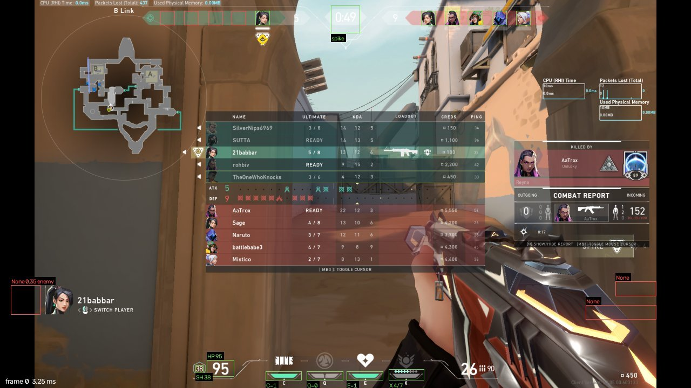
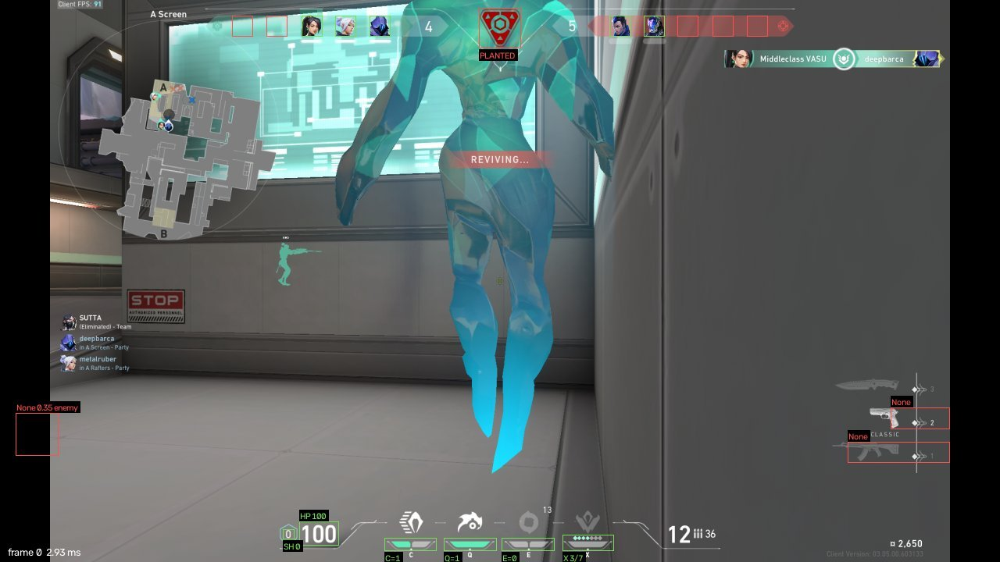

# Testing on real VALORANT 2022 footage

The first version of v2 was tuned only on the synthetic replica. This report covers testing it on **real early-2022 player screenshots**, what broke, how the engine was re-calibrated, and how it now compares with the 2022 engine on frames it was not tuned on.

## Data

| | |
|---|---|
| Source | [deepsidh9/Live-Valorant-Overlay](https://github.com/deepsidh9/Live-Valorant-Overlay) (MIT): test screenshots of a 2021–22 overlay project. Branch `1920x1080` (last commit 6 Jan 2022): 11 frames; `master` (18 Feb 2022): 78 frames at 1920×1200 |
| Game version | late 2021 – February 2022 player HUD (Episode 3 Act 3 – Episode 4 Act I), the same HUD generation as the 2022 Q1 target |
| Frames | 89: 72 with a readable HP, 76 with a readable ability bar, 87 with the standard top bar (2 are deathmatch), 17 with the HUD hidden (dead / spectating) |
| Labels | [`real_eval/real_labels.json`](real_eval/real_labels.json), labelled by hand from zoomed crops: alive per slot (10), spike planted, carrier slot, HP, shield, C/Q/E charges, ult ready |
| Split | **dev = frames 0–44** (used to choose features and thresholds), **test = frames 45–88** (held out). Near-duplicate frames fall within one split |
| Not redistributed | the screenshots stay in their repository; `tools/eval_real.py` explains how to fetch them |

One person labelled everything. While checking a feature I found and fixed one wrong label (frame 41's carrier is slot 3, not 2). Treat single-frame differences of about 1% as noise.

## What the real HUD showed that the replica got wrong

| Element | Real 2022 player HUD | What v2 assumed before |
|---|---|---|
| Dead players | the portrait **disappears**, and survivors **pack towards the centre** of the bar | greyed-out portrait in a fixed slot |
| Alive cue | a health bar under each living portrait (white = your team, grey = enemies) | edge energy only |
| Bottom-left agent portrait | **absent** in the player HUD (spectator HUD only) | used for the current agent and for HUD registration |
| Ability charges | **teal** bar segments, grey when spent, yellow while in use | white pips |
| Ult | teal diamonds; the bar turns teal when ready | white dots / big white block |
| HP digits | the VALORANT HUD font; yellowish below 50 HP | DejaVu Sans |
| Shield | digits inside a teal hexagon, hidden at 0 | plain digits |
| Planted spike | hollow red **inverted triangle**, 25–55% red | filled hexagon > 50% red |
| Spike carrier | white triangle with a yellow ring under the carrier's portrait, over a translucent bar (bright sky shows through) | white diamond on a dark bar |
| 16:10 screens | the HUD is scaled to screen **height** and centred | not handled |

## Baseline: v2 as first shipped vs the 2022 engine (all 89 frames)

| Field | v2 (replica-tuned) | 2022 engine |
|---|---|---|
| alive (per slot) | 98.7% | 99.0% |
| spike planted | 83.9% | 83.9% |
| spike carrier | **35.6%** | 83.9% |
| HP | **8.3%** | 90.3% |
| shield | **23.9%** | 76.1% |

The replica-tuned engine failed exactly where the replica was unrealistic: digit font, the translucent carrier row, and charge colours.

## Changes (all classical, chosen on the dev split)

- **Frame normalisation:** any aspect ratio is height-fitted to 720 px, then centre-padded or centre-cropped to 1280 (16:10 and 21:9 captures).
- **Digits:** real HUD glyphs (`assets/templates/digits_valorant`, MIT, from [Hussbyte101/pixel-hearts-overlay](https://github.com/Hussbyte101/pixel-hearts-overlay)). The reader itself (components plus grey-glyph NCC) is unchanged.
- **Alive:** Sobel-x energy > 110, *or* energy > 40 **and** a health-bar band. On dev, every empty slot in the ambiguous energy range had no bar, and every low-energy live slot had one.
- **Roster identities:** re-matched whenever the alive pattern changes, because packing moves players between slots. Death events compare agent names, not slot flags.
- **Planted:** red ratio ≥ 0.25 **and** red in the triangle's lower tip ≥ 0.6. The red last-seconds round timer never reaches the tip (dev max 0.36, planted min 0.86).
- **Carrier:** greyscale NCC against the real carrier icon (cut from dev frame 26), best cell ≥ 0.55.
- **Abilities and ult:** teal colour gate (G and B well above R), bar-sized components counted; ult ready = a teal component ≥ 70% of the box width.
- **Registration off by default:** its anchor, the bottom-left portrait, does not exist in the player HUD. On real frames it was shifting every ROI by up to 6 px.
- **NCC bug fix:** a flat crop made the vectorised masked NCC divide by ~0, giving a score of 120.9. Flat crops now score 0 (test added).

## Results

`python tools/eval_real.py --root real --legacy` → [`real_eval/results.json`](real_eval/results.json)

**Held-out test split (frames 45–88)**, the honest number:

| Field | v2 | 2022 engine |
|---|---|---|
| alive (per slot, 440) | **99.6%** | 99.3% |
| alive count, your team | **100.0%** | 95.5% |
| alive count, enemies | 95.5% | **97.7%** |
| spike planted | **97.7%** | 88.6% |
| spike carrier | **100.0%** | 79.5% |
| HP (38) | 92.1% | **94.7%** |
| shield (38) | 71.0% | **73.7%** |
| ability charges C/Q/E (123) | **96.8%** | 95.9% |
| ult ready | **100.0%** | 90.2% |
| HUD hidden → HP null | 100% | 100% |

Dev split (0–44), for reference: v2 alive 100%, planted 100%, carrier 97.7%, HP 85.3%, shield 81.8%, charges 96.2%, ult 100%.

v2 is now equal to or better than the 2022 engine on real frames for roster, spike and abilities. It is 70–90× cheaper per frame (no Tesseract). It is still slightly behind on HP and shield:

- **HP misses** (dev 0, 8, 36, 39, 41; test 46, 62, 81): white digits over very bright backgrounds (light sky, teal glass), a bright streak touching yellow low-HP digits (36), and a red tracer line across the digits (39, 41). A white top-hat transform was tried; it was worse on dev, so it was not adopted.
- **Shield misses:** 10 of the 11 test misses read **0** for a real 25/50. The ~9 px digits inside the teal hexagon were not segmented, so the reader fell back to "no shield". This is the clearest next improvement: segment inside the hexagon (teal-outline mask, then digits) instead of using a fixed ROI.

*Held-out frame 87 (Feb 2022): HP 95, shield 38, C 1 / Q 0 / E 1, ult 4/7, spike carrier under slot 5 — all read correctly.*

*Held-out frame 58: spike planted, 3 vs 2 alive, shield 0 in its hexagon.*

## Limits of this test

- 89 frames from **one player's** games. All ten "players" in the real-frame demo replay these frames, so per-player readings are real-pixel readings, but the ten feeds are not one synchronised match.
- No synchronised 10-POV recording of a real 2022 match was obtainable from this environment, where only GitHub is reachable. Fusion is therefore scored on the replica round, now rebuilt in the real HUD style ([SYSTEM.md](SYSTEM.md)).
- **Weapons:** the real player HUD shows the weapon list only briefly after a switch, so these screenshots cannot test the loadout reader.
- **Per-player agent:** no portrait marks "me" in the player HUD, so the agent must be registered by the sender.

To extend the test with your own 2022 VODs: export frames, add rows to `real_labels.json`, and rerun `tools/eval_real.py`.
