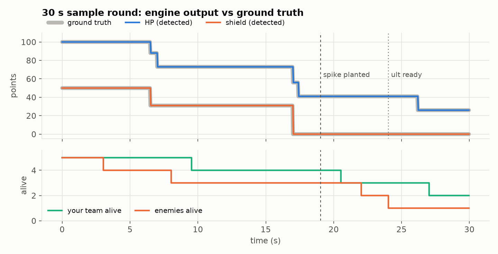
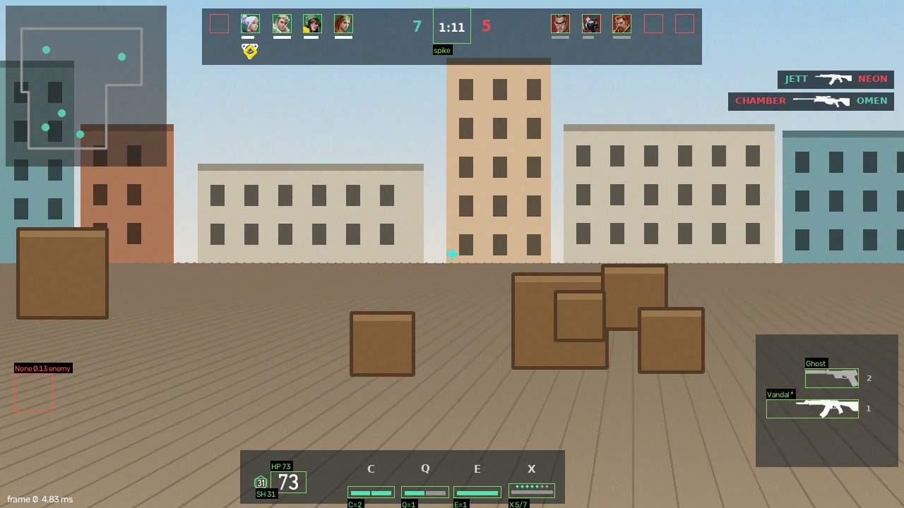

# Sample analysis — 30 s round, VALORANT 2022 Q1 HUD replica

_Generated by `tools/make_figures.py` from `samples/sample_2022q1_30s.analysis.json`._

Video: `sample_2022q1_30s.mp4` (900 frames at 30 fps, 1280x720). Player: **Jett**. Your team: Jett, Sova, Killjoy, Omen, Skye. Enemies: Reyna, Neon, Chamber, Viper, Breach.

## Accuracy per field

Ground truth exists for every frame. *Raw* is the per-frame reading; *tracked* is after the 3-frame vote, which is one frame late at each change.

| Field | Raw | Tracked |
|---|---|---|
| `player.hp` | 100.00 % | 99.44 % |
| `player.shield` | 100.00 % | 99.78 % |
| `ability.c` | 100.00 % | 99.89 % |
| `ability.q` | 100.00 % | 99.89 % |
| `ability.e` | 100.00 % | 99.89 % |
| `ult.points` | 100.00 % | 99.56 % |
| `ult.ready` | 100.00 % | 99.78 % |
| `loadout.primary` | 100.00 % | 100.00 % |
| `loadout.secondary` | 100.00 % | 100.00 % |
| `loadout.active` | 100.00 % | 99.78 % |
| `spike.planted` | 100.00 % | 99.89 % |
| `spike.carrier` | 100.00 % | 99.56 % |
| `roster.alive(10)` | 100.00 % | 99.22 % |
| `roster.agents(10)` | 100.00 % | 100.00 % |
| **overall** | **100.00 %** | **99.76 %** |

## Events detected

Scripted time vs. detected time. All events are found; the constant +1 frame (33 ms) is the vote.

| Detected at | Event | Details |
|---|---|---|
| 3.03 s | `death` | side=right, agent=Reyna |
| 5.03 s | `ability_used` | key=Q, remaining=1 |
| 6.53 s | `damage` | amount=31, hp=88, shield=31 |
| 7.03 s | `damage` | amount=15, hp=73, shield=31 |
| 8.03 s | `death` | side=right, agent=Neon |
| 8.03 s | `ult_point` | points=5 |
| 9.53 s | `death` | side=left, agent=Omen |
| 9.53 s | `spike_picked_up` | slot=4 |
| 11.03 s | `spike_dropped` | slot=4 |
| 12.03 s | `spike_picked_up` | slot=2 |
| 14.03 s | `weapon_switch` | slot=secondary, weapon=Ghost |
| 15.53 s | `ability_used` | key=C, remaining=1 |
| 16.03 s | `weapon_switch` | slot=primary, weapon=Vandal |
| 17.03 s | `damage` | amount=48, hp=56, shield=0 |
| 17.03 s | `shield_broken` |  |
| 17.43 s | `damage` | amount=15, hp=41, shield=0 |
| 19.03 s | `spike_planted` |  |
| 20.53 s | `death` | side=left, agent=Skye |
| 22.03 s | `death` | side=right, agent=Viper |
| 22.03 s | `ult_point` | points=6 |
| 24.03 s | `death` | side=right, agent=Chamber |
| 24.03 s | `ult_ready` |  |
| 25.53 s | `ability_used` | key=E, remaining=0 |
| 26.23 s | `damage` | amount=15, hp=26, shield=0 |
| 27.03 s | `death` | side=left, agent=Sova |
| 28.53 s | `ult_used` |  |

## Timing on this run

Median per-frame latency 2.392 ms (p95 3.573 ms), throughput 225.8 fps including H.264 decode, 1 worker(s). Per-detector medians (ms):

| Stage | ms |
|---|---|
| prepare | 0.406 |
| current_agent | 0.117 |
| roster | 0.516 |
| vitals | 0.4 |
| weapons | 0.265 |
| spike | 0.389 |
| abilities | 0.222 |

Annotated debug video: `samples/sample_2022q1_30s.annotated.mp4`. Example frame:

