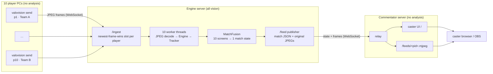

# Match system: 10 players → engine server → commentator server

ValoVision runs as three kinds of process. **All computer vision runs on the engine server.** Player PCs only capture and send their screen. The commentator server only receives and displays.



| Process | Command | Does | Does not |
|---|---|---|---|
| Player sender (×10) | `valovision send` | captures the screen (`mss`), downscales to 1280 px wide, JPEG-encodes, sends | read the HUD, keep state, touch the game process |
| Engine server (×1) | `valovision engine` | decodes, reads every HUD, tracks each player over time, fuses the 10 screens, publishes | render any UI |
| Commentator server (×1+) | `valovision commentator` | subscribes to the engine, relays state and video to browsers, serves the caster UI and MJPEG feeds | analyse anything |

Downscaling and JPEG encoding on the player PC are transport, not analysis. 1280×720 is the engine's design resolution, so sending 1080p would only cost bandwidth.

## Running it

On the engine machine:

```bash
valovision engine --port 8000 --token MATCH_SECRET --forward-fps 10
```

On each player PC (one line per player; `--agent` is the agent picked in the lobby):

```bash
valovision send --engine ws://ENGINE_IP:8000/ingest --token MATCH_SECRET \
                --pid p3 --name Mona --team A --agent Killjoy --source screen --fps 30
```

On the commentator machine:

```bash
valovision commentator --engine ws://ENGINE_IP:8000/feed --token MATCH_SECRET --port 9000
# caster UI:        http://COMMENTATOR_IP:9000/
# one player feed:  http://COMMENTATOR_IP:9000/feeds/p3.mjpeg   (OBS: Media Source, input = this URL)
```

To try it all on one machine with real 2022 frames or the replica round, use `python tools/match_demo.py` (see the README).

## Why the engine needs `team` and `agent` from each player

The player HUD shows both rosters, but **left is always the viewer's own team**, and nothing on screen marks which portrait is the viewer. So each sender registers:

- `team` (A or B), to map a screen's left/right roster to absolute teams;
- `agent`, to link the player to a top-bar portrait. That is how the engine knows a player is dead even though their screen still shows a living HUD: the spectated teammate's.

Both come from the lobby, so a tournament admin can put them in each player's launch script.

## Fusion rules (`valovision/match.py`)

| Field | Source | Rule |
|---|---|---|
| HP, shield, C/Q/E, ult, loadout | the player's own screen | used only while the player is alive. After death the screen shows a teammate's HUD, so values freeze and HP is reported as 0 |
| Player alive | all screens | registered agent ∈ majority-voted alive agents of their team |
| Team alive count | all screens | median of the counts seen by fresh views |
| Spike planted | all screens | majority of fresh views; fuse timer (45 s) runs on the engine clock |
| Spike carrier | all screens | carrier slot → agent in that view → registered player, majority vote |
| Events | fused state | death, damage, ability used, ult ready/used, spike picked up/dropped/planted, alive count change |

A view counts as fresh if its last frame is under 1.5 s old. A disconnected player is shown as offline and excluded from votes until it reconnects; the sender reconnects with back-off by itself.

## Wire protocol

| Link | Messages |
|---|---|
| player → engine `/ingest` | 1. text `{"type":"hello","pid","name","team","agent","token"}` 2. binary: 8-byte big-endian float64 capture time + JPEG |
| engine → player | text `welcome`, then `stats` once a second (fps, processing time, dropped frames) |
| commentator → engine `/feed` | text `{"type":"subscribe","token","frames":true}` |
| engine → commentator | text `{"type":"match", teams, spike, players[], events, recent_events, engine{per-player stats}}`; binary: `uint16 header length · header JSON {pid, frame, capture_ts, recv_ts} · original JPEG` |
| commentator → browser `/ws` | the same messages, relayed unchanged |

The engine never queues frames. If a player sends faster than it can be analysed, the older unprocessed frame is replaced (`dropped` in the stats), so latency cannot build up. Slow commentator connections lose old messages rather than stalling the engine.

## Sizing (measured on this repo's real 2022 frames)

| Quantity | Value |
|---|---|
| JPEG of a 1280×720 HUD frame, quality 80 | ~116 KB (quality 70: ~94 KB) |
| Engine cost per frame | JPEG decode ~3.7 ms + analysis ~1.8 ms ≈ 5.5 ms on one core |
| 10 players × 30 fps | 300 frames/s ≈ 1.7 CPU cores on the engine |
| 10 players × 15 fps | ≈ 0.85 CPU cores |
| Upload per player at 30 fps | ~3.5 MB/s ≈ 28 Mbit/s (15 fps: ~14 Mbit/s) |
| Into the engine, 10 players at 30 fps | ~280 Mbit/s: use a gigabit LAN, or 15 fps / quality 70 |
| Engine → each commentator at `--forward-fps 10` | ~11.6 MB/s ≈ 93 Mbit/s |

On the 16-thread / 18 GB target, the engine needs a small fraction of the CPU (one worker thread per player, OpenCV pinned to one thread each) and well under 1 GB of RAM (~60 MB per player session). The HUD changes slowly, so 15 fps per player is enough for an overlay and halves bandwidth and CPU.

Latency on a LAN, end to end: capture + encode ~15 ms, network < 5 ms, decode + analysis ~6 ms, fusion tick ≤ 1/`match-hz` (67 ms at 15 Hz), relay + browser ~10 ms. That's roughly 100 ms, below what a caster notices. The caster UI shows each feed's measured delay.

## Operational notes

- **Network:** run on a LAN or VPN; do not expose 8000/9000 to the internet. Use `--token`. For `wss://`, put the servers behind a TLS reverse proxy (Caddy, nginx).
- **Clocks:** fusion uses the engine's clock only; player capture timestamps are used for latency statistics. NTP on all machines keeps those statistics honest.
- **Game settings per player:** 16:9 or 16:10, default HUD (the layout is the 2022 Q1 HUD), borderless windowed or fullscreen.
- **Anti-cheat and tournament rules:** the sender captures the screen like OBS does; it never reads game memory, injects input or talks to the game. Check the event's rules before using it in competition.
- **Spectator mode:** the bottom-left portrait and HUD registration only exist in the spectator/observer HUD. They are off by default (`"registration": false` in the layout).
